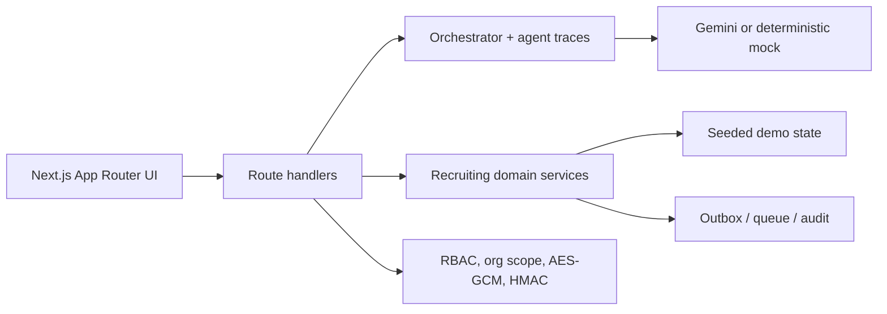

# TalentOS — AI Recruiting Agent

## Setup

```bash
npm install
copy .env.example .env.local
npm run dev
```

Open `http://localhost:3000`.

Optional environment variables:

- `GEMINI_API_KEY` — use Gemini instead of deterministic mock agents.
- `FIELD_ENCRYPTION_KEY` — AES-GCM field-encryption key.
- `WEBHOOK_SECRET` — HMAC webhook-signing secret.

## Architecture



## Module map

| Module | Demo surface |
|---|---|
| M1 | Job analysis and interview blueprint |
| M2 | Candidate pool and matching |
| M3 | Candidate consent, outreach, preferences |
| M4–M5 | Voice/text interview room |
| M6–M7 | Grounded evaluation and reports |
| M8 | Availability, overlap scheduling, ICS |
| M9 | Recruiter dashboard and assistant |
| M10 | 16-stage ATS Kanban |
| M11 | Outbox, templates, channel controls |
| M12 | Derived analytics and predictive insights |
| M13 | Candidate portal |
| M14 | AES-GCM, consent, deletion/export, HMAC |
| M15 | Admin console and adapters |
| M16 | Retries, queue state, idempotent messaging |

## Providers

Without `GEMINI_API_KEY`, agents use deterministic mock responses so the full demo works offline. With a key, Gemini is called through the schema-validating retry wrapper. Email, SMS, calendar, ATS, HRMS, and telephony are mock adapters that write to the in-process outbox.

## Known limitations

This is a demo deployment: state is process-local and resets on server restart. SQLite/Drizzle persistence, production authentication, real provider credentials, and distributed queues are intentionally not included. The UI is white by default with an optional dark toggle.

